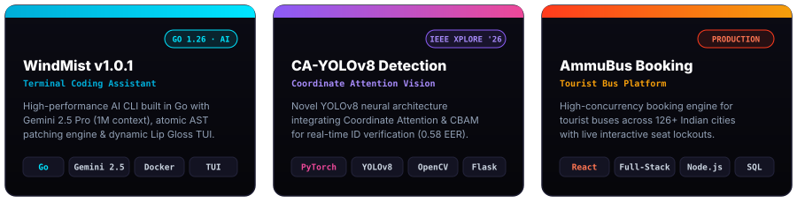

<div align="center">

<!-- ─── CYBERNETIC ELECTRIC HEADER ─── -->
<picture>
  <source media="(prefers-color-scheme: dark)" srcset="assets/terminal-header.svg" />
  <source media="(prefers-color-scheme: light)" srcset="assets/terminal-header.svg" />
  
</picture>

<br/>

<!-- ─── LIVE STATUS HUD ─── -->
<picture>
  <source media="(prefers-color-scheme: dark)" srcset="assets/status-bar.svg" />
  <source media="(prefers-color-scheme: light)" srcset="assets/status-bar.svg" />
  
</picture>

<br/><br/>

<!-- ─── COMMAND CONSOLE / QUICK CONNECT ─── -->
<a href="https://nithwin.site" target="_blank">
  
</a>
<a href="https://ieeexplore.ieee.org/iel8/11502027/11502031/11502277.pdf" target="_blank">
  
</a>
<a href="https://leetcode.com/u/vmnithwin/" target="_blank">
  
</a>
<a href="https://linkedin.com/in/nithwin-v-m-7b5b13252/" target="_blank">
  
</a>
<a href="mailto:vmnithwin@gmail.com">
  
</a>

<br/><br/>

<!-- ─── FEATURED ARCHITECTURES & SYSTEMS ─── -->
<picture>
  <source media="(prefers-color-scheme: dark)" srcset="assets/projects.svg" />
  <source media="(prefers-color-scheme: light)" srcset="assets/projects.svg" />
  
</picture>

</div>

<br/>

### ⚡ Selected Works & System Architectures

| System | Architecture & Capabilities | Stack | Links |
| :--- | :--- | :--- | :--- |
| **[WindMist v1.0.1](https://github.com/Nithwin/windmist)** | **Autonomous Terminal AI Coding Assistant**<br/>Engineered with Google Gemini 2.5 Pro (1M token context window), custom AST atomic transaction disk write engine, multi-agent workspace discovery, and interactive Lip Gloss terminal UI. | `Go 1.26` `Gemini 2.5` `Docker` `Lip Gloss TUI` | [GitHub Repo ↗](https://github.com/Nithwin/windmist) · [Live Demo ↗](https://windmist.vercel.app/) |
| **[CA-YOLOv8](https://github.com/Nithwin/SICD)** | **Smart ID Card Detection & Recognition (IEEE Xplore 2026)**<br/>Custom computer vision neural pipeline embedding Coordinate Attention (CA) and Convolutional Block Attention Module (CBAM) into YOLOv8. Tested on 800+ cards achieving **0.58 Equal Error Rate (EER)**. | `Python` `YOLOv8` `PyTorch` `OpenCV` `Flask` | [GitHub Repo ↗](https://github.com/Nithwin/SICD) · [IEEE Paper ↗](https://ieeexplore.ieee.org/iel8/11502027/11502031/11502277.pdf) · [Live App ↗](https://sicd.vercel.app) |
| **[AmmuBus](https://github.com/Nithwin/ammubus-web)** | **Production Tourist Bus Booking Engine**<br/>Comprehensive booking platform serving 126+ cities across India. Features verified operator fleets, sub-second route search, interactive SVG seat allocation, and atomic transaction locks. | `React` `JavaScript` `Node.js` `Express` `REST` | [GitHub Repo ↗](https://github.com/Nithwin/ammubus-web) · [Live Site ↗](http://ammubus.in/) |
| **[ShadowCoders](https://github.com/Nithwin)** | **Real-Time Collaborative Developer Platform**<br/>Full-stack collaborative engineering environment with live workspace sync, isolated containerized execution sandboxes, and low-latency developer tooling. | `TypeScript` `Next.js` `Express.js` `Docker` `Socket.io` | [GitHub Profile ↗](https://github.com/Nithwin) |

<br/>

### 🛠️ Technical Arsenal & Core Stack

```text
┌── [01] SYSTEMS & CORE ────────────► Go 1.26 · C++20 · Python 3.12 · Linux Kernel · Sockets · Bash
├── [02] ARTIFICIAL INTELLIGENCE ───► PyTorch · YOLOv8 · Coordinate Attention · OpenCV · LLM Agentics · RAG
├── [03] FULL-STACK & WEB ──────────► React 19 · Next.js · TypeScript · FastAPI · Node.js · REST APIs
├── [04] DATA & INFRASTRUCTURE ─────► PostgreSQL · Redis · Docker · Kubernetes · Google Cloud · Firebase
└── [05] ALGORITHMIC RIGOR ─────────► 800+ LeetCode Solved · Graph Theory · Dynamic Programming · Low-Level Memory
```

<div align="center">
  
</div>

<br/>

### 📊 GitHub Activity & System Diagnostics

<div align="center">

<table border="0">
  <tr>
    <td width="50%" align="center">
      
    </td>
    <td width="50%" align="center">
      
    </td>
  </tr>
  <tr>
    <td colspan="2" align="center">
      
    </td>
  </tr>
</table>

<br/>

```text
 ╭─────────────────────────────────────────────────────────────────────────────╮
 │                                                                             │
 │    "Engineering Kinetic Realities — Bridging algorithmic depth with         │
 │     clean, resilient, and high-performance software systems."               │
 │                                                                             │
 ╰─────────────────────────────────────────────────────────────────────────────╯
```

<sub>Crafted with kinetic focus · Built by <b>Nithwin (Nithwin V M)</b> · <a href="https://nithwin.site">nithwin.site</a></sub>

<br/><br/>


<br/>

</div>
